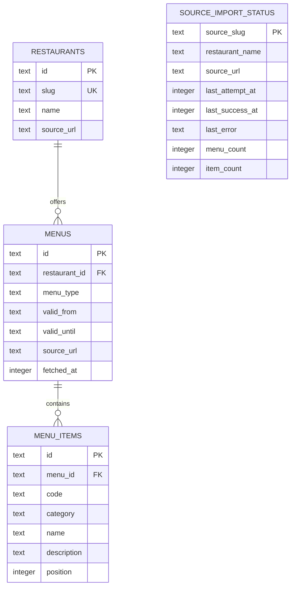

# Data model

This document describes the SQLite model implemented in `src/lib/server/db/schema.ts` and initialized in `src/lib/server/db/index.ts`. Update it whenever the schema or persistence behavior changes.

## Entity relationship

`source_import_status` is keyed by source and intentionally has no foreign key to `restaurants`: an import can fail before a restaurant record is stored.

## Tables

### `restaurants`

One row per restaurant.

| Column       | Meaning                                                  |
| ------------ | -------------------------------------------------------- |
| `id`         | UUID primary key.                                        |
| `slug`       | Stable, unique application identifier used by importers. |
| `name`       | Display name.                                            |
| `source_url` | Canonical URL used to obtain the menu.                   |

### `menus`

One row per daily or weekly menu period.

| Column                      | Meaning                                                                                     |
| --------------------------- | ------------------------------------------------------------------------------------------- |
| `id`                        | UUID primary key.                                                                           |
| `restaurant_id`             | Parent restaurant; deleting the restaurant cascades to its menus.                           |
| `menu_type`                 | `daily` or `weekly`.                                                                        |
| `valid_from`, `valid_until` | Inclusive validity dates in `YYYY-MM-DD` format. A daily menu uses the same value for both. |
| `source_url`                | URL from which this menu was imported.                                                      |
| `fetched_at`                | Import time as Unix epoch milliseconds.                                                     |

The unique index on (`restaurant_id`, `menu_type`, `valid_from`) makes importer upserts idempotent for a menu period.

### `menu_items`

Ordered dishes or offers belonging to a menu.

| Column        | Meaning                                                          |
| ------------- | ---------------------------------------------------------------- |
| `id`          | UUID primary key.                                                |
| `menu_id`     | Parent menu; deleting the menu cascades to its items.            |
| `code`        | Optional source code, stored as an empty string when absent.     |
| `category`    | Optional grouping or heading, such as a bowl category.           |
| `name`        | Dish or offer name.                                              |
| `description` | Normalized description, including relevant options or additions. |
| `position`    | Zero-based display order within the menu.                        |

The unique index on (`menu_id`, `position`) preserves one ordered list per menu. Import replaces a menu's item list transactionally.

### `source_import_status`

Latest operational status for each import source. A source may represent a restaurant website or document URL; it is independent from the restaurant/menu records.

| Column                          | Meaning                                                                                   |
| ------------------------------- | ----------------------------------------------------------------------------------------- |
| `source_slug`                   | Stable primary key for the importer.                                                      |
| `restaurant_name`, `source_url` | Display label and current source URL.                                                     |
| `last_attempt_at`               | Most recent import attempt, Unix epoch milliseconds.                                      |
| `last_success_at`               | Most recent successful import, Unix epoch milliseconds; `NULL` if there has not been one. |
| `last_error`                    | Generic failure indicator/message; `NULL` after success or while no failure is recorded.  |
| `menu_count`, `item_count`      | Counts from the most recent successful import; `NULL` before the first success.           |

## Import and persistence behavior

1. Each source parser converts its website or PDF into normalized menu plans and ordered items.
2. A transaction upserts the restaurant and each menu by restaurant, type, and start date.
3. For each menu, the importer replaces its item rows in source order. If any write fails, the transaction rolls back.
4. Import status records attempts, the last successful timestamp and counts, or a failure indicator. A failed attempt does not erase the last successful timestamp or counts.
5. SQLite foreign-key enforcement is enabled when the database connection opens. The application creates missing tables and indexes at startup; this is additive initialization, not a versioned migration system.

## Deliberate current scope

- Prices, raw source snapshots, user accounts, and reminders are not stored in SQLite.
- Favorite dish terms are saved in the browser's `localStorage`; they are device/browser-specific and are not synchronized.
- Menu dates use ISO date strings; import timestamps use integer milliseconds.
- `menu_type` is represented as a TypeScript enum in Drizzle, while the SQLite table currently has no `CHECK` constraint for its values.
